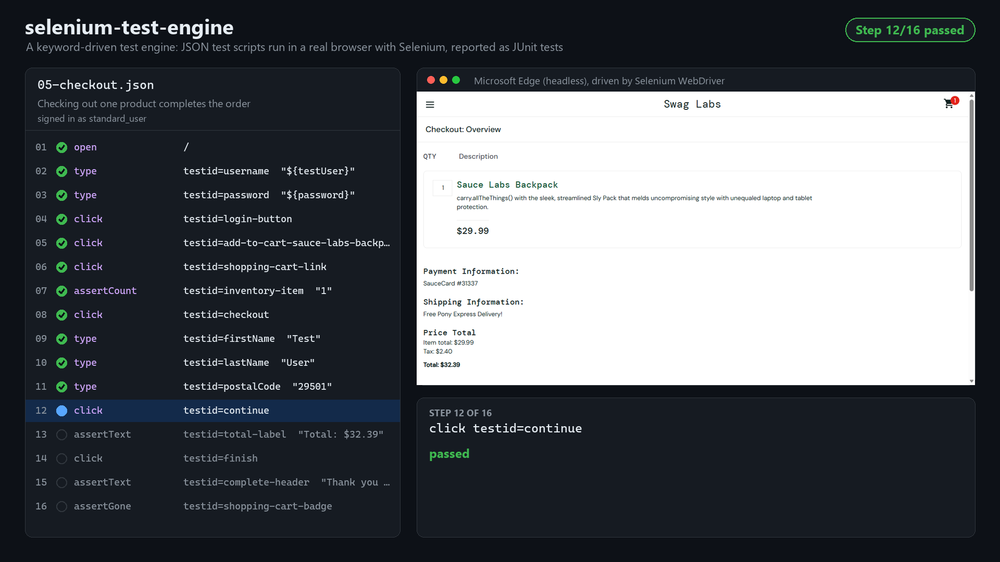
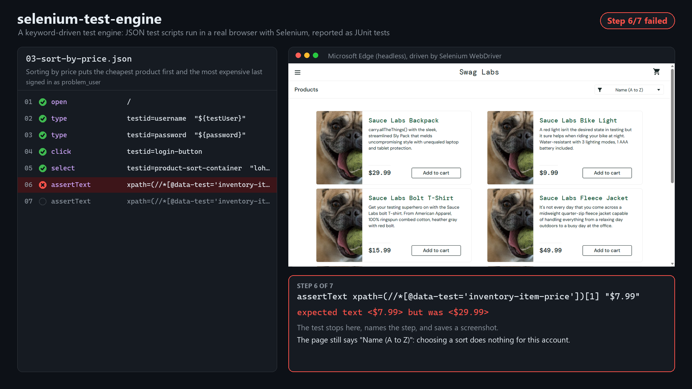

# Selenium Test Engine

[](https://github.com/jroberts0907/selenium-test-engine/actions/workflows/tests.yml)

Automated UI tests for [Sauce Demo](https://www.saucedemo.com), a practice e-commerce site, written in Java with
Selenium 4 and JUnit. The project has two parts:

1. **Page-object test suite**: 17 JUnit tests covering login, product sorting, the cart and checkout
2. **Keyword-driven engine**: test cases written as JSON steps, run through Selenium as JUnit tests, so a new
   test case is a new JSON file with no Java changes



When a step fails, the engine stops, names the step, and shows expected against actual:



These frames are the engine's own step screenshots (`-DrecordSteps=true`), laid out side by side with the script.

## Requirements

- JDK 21 or newer
- Chrome, Edge or Firefox. Selenium Manager downloads the matching driver (and Chrome, if it's missing) on first run.

Maven doesn't need to be installed. The Maven wrapper (`mvnw`) downloads it.

## Running the tests

```sh
./mvnw test                                  # headless Chrome
./mvnw test -Dbrowser=edge                   # chrome | edge | firefox
./mvnw test -Dheadless=false                 # watch the browser
./mvnw test -Dtest=SmokeTest                 # one test class
./mvnw test -DtestUser=problem_user          # sign in as a different test account
./mvnw test -DrecordSteps=true               # screenshot every script step to target/evidence/
./mvnw test -DwindowSize=1280,800            # browser size (default 1920,1080)
./mvnw test -Dtimeout=5                      # seconds to wait for elements (default 10)
./mvnw test -Dtest=KeywordScriptsTest -Dscripts=checkout   # only scripts whose file name contains "checkout"
```

On Windows, use `mvnw.cmd` in place of `./mvnw`.

To run against a Selenium Grid or container instead of a local browser, set `SELENIUM_REMOTE_URL`
(for example `http://localhost:4444`).

### Running against a local copy of the site

Sauce Demo is open source ([saucelabs/sample-app-web](https://github.com/saucelabs/sample-app-web), MIT), so the
suite can run against a local copy instead of the public site:

```sh
git clone https://github.com/saucelabs/sample-app-web.git
cd sample-app-web
npm ci --ignore-scripts
npx vite                                     # serves http://localhost:3000
```

Then point the tests at it:

```sh
./mvnw test -DbaseUrl=http://localhost:3000
```

## Continuous integration

[`.github/workflows/tests.yml`](.github/workflows/tests.yml) runs on every push to `main` and every pull request:

- **Suite**: the full default suite in Chrome, Firefox and Edge, in parallel. Each browser runs in its own
  `selenium/standalone-<browser>` container, and the tests connect to it through `SELENIUM_REMOTE_URL`. A failure
  fails the build and uploads that run's screenshots and test reports as artifacts.
- **Known defects**: the `known-defect` tests in Chrome. They're expected to fail, so they don't fail the build.
  The job summary lists which defects are still present and warns if one starts passing (the bug may be fixed, so
  the test belongs in the main suite). Defect screenshots are uploaded every run.

Each job writes a results table to its summary page
([`.github/scripts/test_summary.py`](.github/scripts/test_summary.py)). CI tests the public site at saucedemo.com.

## Keyword-driven engine

Test scripts live in [`src/test/resources/scripts/`](src/test/resources/scripts). Each JSON file is one test:

```json
{
  "name": "Signing in shows the product list",
  "steps": [
    { "action": "open", "target": "/" },
    { "action": "type", "target": "testid=username", "value": "${testUser}" },
    { "action": "type", "target": "testid=password", "value": "${password}" },
    { "action": "click", "target": "testid=login-button" },
    { "action": "assertUrlContains", "value": "/inventory.html" },
    { "action": "assertText", "target": "testid=title", "value": "Products" },
    { "action": "assertCount", "target": "testid=inventory-item", "value": "6" }
  ]
}
```

`KeywordScriptsTest` turns every file into its own JUnit test (a `@TestFactory` of dynamic tests), named by the
script's `name` and run in a fresh browser.

| Action | Needs | Does |
|---|---|---|
| `open` | target | Opens a path on the site under test (or a full URL) |
| `click` | target | Waits until clickable, then clicks |
| `type` | target, value | Clears the field and types the value |
| `select` | target, value | Picks a dropdown option by its value |
| `assertText` | target, value | Text equals the value (waits up to 10 s for it to match) |
| `assertVisible` | target | Element is visible |
| `assertGone` | target | Element is hidden or removed |
| `assertCount` | target, value | Exactly that many elements match |
| `assertUrlContains` | value | Current URL contains the value |

**Targets** are CSS selectors by default, or use a prefix: `testid=username` (`[data-test='username']`),
`id=user-name`, `xpath=(//button)[1]`, `css=.title`.

**Variables**: `${testUser}` (from `-DtestUser`, default `standard_user`) and `${password}`, so the same script
runs as any account.

**Checked before running**: scripts are parsed and checked before any browser starts. An unknown action, a missing
field, or a misspelled one (`"valu"`) fails right away with the file and step number:

```
05-checkout.json: step 9: unknown action "clik". Known actions: open, click, type, select, assertText, ...
```

**Failures name the step** and save a screenshot to `target/screenshots/script_<name>.png`:

```
Step 6 of 7 failed: assertText xpath=(//*[@data-test='inventory-item-price'])[1] "$7.99"
expected text <$7.99> but was <$29.99>
```

**Step evidence**: with `-DrecordSteps=true`, every step's screenshot is saved to
`target/evidence/<script>/` as `01-passed.png`, `02-passed.png`, ..., with `NN-failed.png` and `failure.txt` for a
failing step, and `steps.csv` records when each step started and ended. So there is a record of exactly what each
test saw, and when.

**Video**: with `-DrecordVideo=true` (Chrome or Edge), the engine records the page through the Chrome DevTools
screencast to `target/evidence/<script>/frames/`, with each frame's capture time in `frames.csv`. Only the page is
recorded, never the desktop, and it works headless. The capture times line up with `steps.csv`.

**Demo mode**: `-DstepDelay=700 -Dhighlight=true` pauses before each step, outlines the element it's about to use
(purple for actions, green for assertions, red when a step fails), and types one character at a time, so a person
can follow along. These pauses are the project's only sleeps; no test depends on them.

```sh
# Record the checkout script in demo mode
./mvnw test -Dtest=KeywordScriptsTest -Dscripts=checkout -Dbrowser=edge \
  -DstepDelay=700 -Dhighlight=true -DrecordSteps=true -DrecordVideo=true -DwindowSize=1280,800
```

The engine has its own unit tests (`KeywordEngineTest`) for parsing, checking, locators and variables. They run
without a browser.

## Known defects

Sauce Demo ships test accounts with bugs built in. Running the suite as each of them
(`./mvnw test -DtestUser=problem_user`) found the 11 defects below. `KnownDefectsTest` asserts the correct behavior
for each one, so those tests fail until the bug is fixed. They're tagged `known-defect` and left out of the default
run so the main suite stays green; run them on their own with:

```sh
./mvnw test -Pknown-defects
```

| Account | Defect | What the test sees | Caught by |
|---|---|---|---|
| `problem_user` | Sorting does nothing | Prices stay in default order after choosing "Price (low to high)" | `ProblemUser.sortingWorks`, `InventoryTest` |
| `problem_user` | Half the products can't be added to the cart | Adding all 6 products leaves the badge at 3 | `ProblemUser.everyProductCanBeAdded` |
| `problem_user` | The other half can't be removed from the product list | Remove on the backpack leaves the badge at 1 | `ProblemUser.productCanBeRemoved`, script `04` |
| `problem_user` | Every product shows the same broken image | All 6 image URLs are `sl-404.jpg` | `ProblemUser.productImagesAreDistinct` |
| `problem_user` | Typing a last name overwrites the first name instead | Checkout never gets past step one; the wrong field errors are shown | `ProblemUser.checkoutAcceptsValidDetails`, `CheckoutTest` |
| `error_user` | Sorting fails with an alert | "Sorting is broken! This error has been reported to Backtrace." | `ErrorUser.sortingWorks`, `InventoryTest` |
| `error_user` | Half the products can't be added to the cart | Adding all 6 products leaves the badge at 3 | `ErrorUser.everyProductCanBeAdded` |
| `error_user` | A missing last name isn't rejected | Checkout continues with no error | `ErrorUser.missingLastNameIsRejected`, `CheckoutTest` |
| `error_user` | Finish doesn't complete the order | The confirmation page never appears | `ErrorUser.finishCompletesOrder`, `CheckoutTest` |
| `visual_user` | Prices on the product list are wrong | Backpack shows a random price instead of $29.99 | `VisualUser.pricesMatchCatalog`, `InventoryTest` |
| `performance_glitch_user` | Login is slow | About 6 s to reach the product list (budget: 3 s) | `PerformanceGlitchUser.loginIsFast` |

`performance_glitch_user` passes the rest of the suite: the explicit waits (10 s) absorb the delay, which is why
the slow login needs its own timing check. `visual_user` also has layout bugs (a misplaced cart icon, for one) that
a functional test can't see; catching those takes visual regression testing.

## Project layout

```
src/test/java/io/github/jroberts0907/engine/
├── SmokeTest.java                # browser starts and the site is up
├── LoginTest.java                # valid login and rejected logins
├── InventoryTest.java            # sorting and the cart badge
├── CartTest.java                 # adding, removing, continue shopping
├── CheckoutTest.java             # full purchase, totals, form validation
├── KnownDefectsTest.java         # one test per bug in the buggy test accounts (tag: known-defect)
├── KeywordScriptsTest.java       # runs each JSON script as a JUnit dynamic test
├── keyword/                      # the keyword-driven engine
│   ├── Script.java, Step.java    # a script and its steps, as read from JSON
│   ├── Keyword.java              # the actions and the fields each one needs
│   ├── ScriptLoader.java         # reads and checks scripts before any browser starts
│   ├── KeywordRunner.java        # runs steps in a browser and reports the failing step
│   ├── Locators.java             # testid= / id= / xpath= / css= targets
│   ├── Variables.java            # ${name} placeholders
│   ├── DemoMode.java             # optional pacing and highlighting for watching or recording
│   └── KeywordEngineTest.java    # unit tests for the engine (no browser)
├── pages/                        # page objects: locators and actions, no assertions
│   ├── BasePage.java             # explicit-wait helpers and the shared header
│   ├── LoginPage.java
│   ├── InventoryPage.java
│   ├── CartPage.java
│   ├── CheckoutInfoPage.java
│   ├── CheckoutOverviewPage.java
│   └── CheckoutCompletePage.java
└── support/
    ├── BaseTest.java             # fresh browser per test
    ├── ScreenshotOnFailure.java  # saves target/screenshots/<Test>_<name>.png on failure
    ├── Screenshots.java          # shared screenshot saving for tests and scripts
    ├── BrowserRecorder.java      # page video through the DevTools screencast
    ├── TestUsers.java            # saucedemo.com test accounts
    ├── Config.java               # run settings from -D system properties
    └── DriverFactory.java        # local or remote WebDriver for the chosen browser
```

Tests only talk to page objects, never to locators, so a change to the site means fixing one page class rather
than every test. Waits are explicit (`WebDriverWait`); the only `Thread.sleep` is demo mode's optional pacing.
